# Vibe Scaler — workflow (full system)

This document is the **in-depth map** of how Vibe Scaler scales development: from a raw idea through governed ideation, acceptance, chunked execution, automated tests, code review, human verification, and goat close. The **playground on disk** is the system of record; agent skills are **entrypoints** that read and write those files.

**Who decides:** the **orchestrator** (human in the chat) runs the menu, says **proceed**, confirms each checklist, and approves git. The **goat** is the senior owner and the only final close. The **executionist** is the senior engineer’s hands: it executes the active chunk because the plan, rules, and knowledge base already decided the work. It does not invent scope. A plan gap or two readings of the plan means **stop and ask**. Replies stay crisp: doing / did / next (`VOICE.md`).

Related: [CONTEXT.md](./CONTEXT.md) (pasteable summary), [SYSTEM-PATHS.md](./SYSTEM-PATHS.md) (path index), [VOICE.md](./VOICE.md) (how agents talk), [README.md](./README.md), [INSTALL.md](./INSTALL.md).

---

## How agents talk (every skill)

All Vibe Scaler skills follow **[VOICE.md](./VOICE.md)**:

- **Plain English first** — what we’re doing, why, what you need to do (or that you can wait).
- **Technical detail second** — file paths, statuses, frameworks so pros know exactly what’s meant.
- **Doing · did · next** during build and test loops.
- User writes **`pro`** → denser staff-engineer language is OK.

Newcomers should never need to decode “B′ handoff” without a human sentence in front of it.

---

## Context layers (hub → program → person)

| Layer | Path | Maintained by |
|-------|------|----------------|
| **Playground hub** | `docs/idea-to-reality-playground/CONTEXT.md` | `/vs-hub`, ideator, executionist |
| **Quick tree** | `quick-index.md` | Same — programs, chunks, operators, avg score |
| **User (repo-wide)** | `users/<kebab>/onboarding.json`, `profile.json` | `/vs-hub` (MCQs + tutorial flag) |
| **Program rollup** | `NN_<short>/context/summary.md` | Executionist, performance-review |
| **Operator (per program)** | `operators/<kebab>/context.md`, `handoffs.md` | Executionist (identity asked if chat unknown) |
| **Performance** | `performance/scores.json` | `vs-performance-NN-*` after chunk session |

**Takeover:** read `CONTEXT.md` → program `context/summary.md` → `operators/index.md` → active person’s folder. Git history + session scores supplement chat.

**Entry:** **`/vs-hub`** — numbered menu (ideator options before executionist), tutorial, role help, routes to slash skills.

---

## What Vibe Scaler is

**Vibe Scaler** is a portable kit (`vibe-scaler/` + skills + governance rules) installed into any host repo (via **goat-utils** `ide-init`). It is designed so that:

- **Many people and many IDEs** (Cursor, Antigravity, Claude Code, Codex) can work on the **same program** without losing context.
- **Ideation** stays crisp (copilot, not autopilot); **execution** stays governed (checklists, tests, review, ingest).
- **Scaling** means adding programs (`01_`, `02_`, …), splitting huge ideas (>15 chunks), and repeating the **same per-chunk pipeline** until the product is real.

It explicitly separates:

| Concern | Mechanism |
|---------|-----------|
| Vision & plan | Ideator + `plan/` + `implementation-index.md` |
| “What should it look like?” | Checker wireframes (`verification/chunks/*.html`, `ideator.html`) |
| “Did we build it?” | Executionist + auto-tests + git (optional) |
| “Does it match intent?” | Human acceptance HTML → checker **ingest** |
| “Is the program officially done?” | Goat verifier (MD5) → **`closed`** |
| “Who was on this chunk? How well?” | `operators/<kebab>/` + `performance/scores.json` |
| “Where is everything?” | Hub **`CONTEXT.md`** → program **`context/summary.md`** → person folders |

---

## Why it exists (scaling development)

Without a file-backed workflow, teams scale chat threads, not software. Vibe Scaler scales by:

1. **Chunking** — Each chunk fits one agent context + one operator session (≤15 per program; more → planner split).
2. **Numbered skills** — `executionist-02-foo` is searchable and **self-contained** (paths + full playbook inlined).
3. **Handoffs** — `auto-tests/last-handoff.json` chains executionist → auto-tests without “start over.”
4. **Statuses** — `status.json` tells humans and `/vs-auto-execute-*` where the program stalled.
5. **Proof layers** — Tests (B′), policy review, optional goat code review, intern HTML, performance scores, goat close.
6. **Context hub** — Summaries + **quick-index** so takeovers do not depend on chat memory (git-reviewable operator folders).

---

## Skill numbering

| Prefix | Meaning | Examples |
|--------|---------|----------|
| **—** | Hub (no NN) | **`vs-hub`** → `/vs-hub` — menu, tree, onboarding, routes |
| **00** | Base / kit-wide | `vs-ideator`, `vs-executionist`, `vs-auto-tests`, `vs-jr-goat`, `vs-code-reviewer`, `vs-performance`, `vs-auto-execute`, `vs-goat`, `vs-planner`, `vs-harness` |
| **NN** | One program | `NN` matches folder `NN_<short>/` — e.g. `vs-executionist-03-billing-api`, `vs-jr-goat-03-billing-api` |

Per-program skills are generated from **`vibe-scaler/templates/skills/*`** at ideation time (includes **vs-jr-goat-NN** and **vs-performance-NN**).

---

## Roles

| Role | Who | Primary skills |
|------|-----|----------------|
| **Hub** | Anyone | **`/vs-hub`** — menu, **quick-index**, onboarding, MCQ profile, routes |
| **Router** | Anyone lost | **`/vs-hub`** (menu **8**) or `/vs-auto-execute` |
| **Planner** | Agent | `/vs-planner` when idea >15 chunks |
| **Ideator (owner)** | Human | Decides; `/vs-ideator`, `/vs-ideator-NN-*` copilot warns/suggests |
| **Checker** | Agent | `/vs-checker-NN-*` — wireframes, ingest |
| **Executionist** | Agent | `/vs-executionist-NN-*` — executes the chunk for the orchestrator; attends the goat; does not decide scope |
| **Auto-tests** | Agent | `/vs-auto-tests-NN-*` — canonical test stack after Turn B |
| **Jr goat** | Agent suggests; human decides | `/vs-jr-goat-NN-*` — after tests, before checklist; sub-chunks on the same plan |
| **Code reviewer** | Agent / goat read | `/vs-code-reviewer-NN-*` — per-chunk MD + git + index |
| **Operator** | Human driver | Name, **proceed**, checklist, HTML, commit OK |
| **Goat (senior)** | Human | `/vs-goat` — final **closed** |
| **Performance** | Agent | `/vs-performance` or `/vs-performance-NN-*` — session score + average |
| **Harness** | Dev | `/vs-harness` — IDE mirror verify only |

---

## Playground layout (host repo)

```text
docs/idea-to-reality-playground/
  CONTEXT.md                  # hub summary → sub-contexts (maintained)
  quick-index.md              # program/chunk/operator/score tree (maintained)
  users/<kebab>/              # onboarding.json · profile.json (MCQs, repo-wide)
  index.md                    # registry of all programs
  context-attendance-log.md   # plan-read / adherence
  archives/NN_short/          # moved when status = archived
  NN_short-title/             # one program (PROGRAM_ROOT)
    context/summary.md        # program rollup (maintained)
    index.md · status.json
    original-prompts.md
    plan/index.md · plan/chunks/*.md
    implementation-index.md
    implementation-checklist.md
    implementation-log.md
    operators/index.md
    operators/<kebab>/context.md · handoffs.md
    performance/scores.json   # per-chunk session scores + average
    verification/ideator.html · verification/chunks/<id>.html
    verification/acceptance-*.json
    auto-tests/last-handoff.json · auto-tests/<id>/{spec,results,generated-checklist}.json|.md
    reviews/chunk-<id>.md
    goat-verification-complete.md   # MD5 digest only
```

**Big ideas:** `goat-planner-tmp/` at repo root → multiple `/vs-ideator` runs from `split-index.md`.

---

## Program status (standard)

Stored in **`status.json`** and mirrored in **`index.md`** (custom strings allowed in notes).

| Status | Meaning |
|--------|---------|
| `ideation` | Plan being written / refined |
| `executing` | Active chunk work |
| `iteration` | Executionist improving subpar chunk before handoff |
| `auto_tests_running` | B′ in progress |
| `code_review_pending` | Waiting for / producing goat-facing review |
| `code_review_iteration` | Agent writing `reviews/chunk-*.md` |
| `human_checklist_pending` | Turn C — intern confirms checklist |
| `verification_pending` | Acceptance HTML not fully ingested |
| `goat_verification_pending` | Ready for senior MD5 close |
| `blocked` | Plan gap / secret — senior outside chat |
| `closed` | Goat verified |
| `cancelled` / `discarded` | Abandoned (no archive unless asked) |
| `archived` | Folder moved to `playground/archives/` |

---

## Phase 0 — Hub menu (any time)

**Skill:** **`/vs-hub`** (preferred) or `/vs-auto-execute`

`/vs-hub` — numbered menu, rebuilds **quick-index**, onboarding + **3 MCQs** → `users/<name>/profile.json`, role picker (default teach path: **executionist driver**), option **0** = end-to-end tutorial.

## Phase 0a — Orientation (lightweight)

**Skill:** `/vs-auto-execute` or `/vs-auto-execute-NN-<short>` (menu **8**)

1. Ask **name** and **role** (ideator | operator | intern | goat).
2. Scan playground index, `status.json`, `last-handoff.json`, checklist, log.
3. Output: **one recommended slash command** + why; optional second half-done program.

Use whenever the team does not know “what now.”

---

## Phase 0b — Huge idea split (optional)

**When:** End-to-end app or **>15 executable chunks** per program.

**Skill:** `/vs-planner`

1. Fill `goat-planner-tmp/original-big-idea.md`.
2. Write `split-index.md` — child programs, each ≤15 chunks, dependency order.
3. For each row: run **`/vs-ideator`** with that slice only.

---

## Phase 1 — Ideation

**Skill:** `/vs-ideator` (new) or `/vs-ideator-NN-<short>` (refine)

**Agent role:** Copilot — **warn, suggest, tell**; owner decides. Append all owner text to **`original-prompts.md`**.

### Steps (vs-ideator)

1. Pick next `NN` in playground `index.md`.
2. Ensure playground hub once per repo: **`CONTEXT.md`**, **`quick-index.md`**, **`users/_template/`** (from `vibe-scaler/templates/`).
3. Create **`NN_<short>/`** from `vibe-scaler/templates/idea-folder/` including **`context/summary.md`**, **`performance/scores.json`**, **`operators/`** (`index.md`, `_person-template/`).
4. Build **`plan/`** + **`implementation-index.md`** + **`plan/chunks/<id>.md`** (N ≤ 15) — deliverables, **test_target**, verify commands, literal UI copy, stop conditions.
5. **`implementation-checklist.md`**, **`implementation-log.md`**, **`status.json`** (`ideation`).
6. Optional stack hints (listed types only; see ideator-governance).
7. Generate **NN skills**: vs-ideator, vs-checker, vs-executionist, vs-auto-tests, **vs-jr-goat**, vs-code-reviewer, vs-auto-execute, **vs-performance**.
8. **`goat-verification-complete.md`** (digest only).
9. Refresh **`quick-index.md`** + program **`context/summary.md`** + playground **`index.md`**.

**Output:** A program **executable in order**; humans start at **`/vs-hub`** or checker → executionist.

---

## Phase 1b — Acceptance (visual contract)

**Skill:** `/vs-checker-NN-<short>` — generate | refine wireframe | ingest

### Generate

1. Per chunk: **`verification/chunks/<id>.html`** — literal wireframes + verify checkboxes + JSON export.
2. **`verification/ideator.html`** — hub with iframes to all chunk pages (ideator reviews whole product).
3. **`acceptance-criteria.json`** / **`acceptance-state.json`**.

### Refine

Ideator reviews HTML; **refine wireframe** until approved. Mocks use **literal copy** from plan (no lorem).

### Ingest (later, Phase 3)

Human ticks real app against HTML → paste JSON → updates checklist + log.

**Gate:** Do not treat execution as “aligned with product” until wireframes are approved.

---

## Phase 2 — Execution (per chunk)

**Entrypoint:** `/vs-executionist-NN-<short>` (must load full contract from skill + `vs-executionist`)

**Traverse tree:** `implementation-index.md` → active **`plan/chunks/<id>.md`** — not the skill file.

### Turn A — Before code (every chunk)

1. **Briefing** for this operator (3–6 sentences).
2. **`### Learn more (paste into your favourite AI)`** — external teach prompt (chunk engineering only; no pipeline jargon).
3. Up to **5 questions**; answers in **`operators/<kebab>/context.md`**.
4. **Identity** — if chat has no name, ask; ensure **`users/<kebab>/`** exists; load **`profile.json`** for **VOICE** depth.
5. **Proceed gate** — no file writes until **proceed** + operator name (cold start).

### Turn B — Implement

1. Implement **only** active chunk deliverables.

### Turn B.i — Quality iteration (agent-only)

If subpar vs chunk doc / acceptance HTML:

- Status → **`iteration`**
- Improve and log; **do not** ask intern yet
- Repeat until on-par or **blocked**

### Handoff → Turn B′ (auto-tests)

1. Write **`auto-tests/<chunk-id>/spec.json`** (target, verify_commands, filesystem_assertions).
2. Write **`auto-tests/last-handoff.json`** (`next_skill`, `expected_user_input`, `pending`).
3. Announce next skill to user.
4. **Same session:** follow **`vs-auto-tests-NN-<short>`**.

### Turn B′ — Auto-tests + policy review

**Kit:** `vibe-scaler/vs-auto-tests/`

| Target | Framework |
|--------|-----------|
| Backend / API | **pytest** |
| Web | **Playwright** (default UI E2E) |
| React Native | Jest + RNTL + **Detox** |
| Flutter | flutter_test + integration_test |
| Electron | Vitest/Jest + Playwright Electron |
| Filesystem | Node/Python assertions |

**Flow:** `spec.json` → profile → generate/update tests → **`run-tests.ps1`** → **`generate-checklist.md`** → **policy code review** → refine → **re-test loop** until pass.

- Short summary: **`reviews/chunk-<id>-auto.md`**
- If goat needs full review: status **`code_review_pending`** → **`/vs-code-reviewer-NN-*`** → **`reviews/chunk-<id>.md`** (2 crisp bullets + pseudocode + mermaid + diff highlights per chunk; uses **index-extractor** + git)

### Jr goat refinements (before Turn C)

**Skill:** `/vs-jr-goat-NN-<short>` (menu **6**). Executionist **always** prints a verdict first: **recommend**, **optional**, or **skip**, and whether that skill is the next step.

The agent looks at what just changed and may suggest only these genres (ask “is this a problem?”):

1. Loaders and progress — wait states that do not say what is happening  
2. Feel and layout — the screen feels off versus the wireframe  
3. Honest data — placeholder or AI-looking data shown as real  
4. Errors and empty — silent or generic failure  
5. Labels match actions — the control does not do what it says  

The human is the ideator for these calls. Accepted items (max **three** per pass) become **sub-chunks** on the parent (`plan/chunks/<id>-jr-<n>.md` + a section on the parent chunk). They do not start a new program and do not count toward the 15-chunk cap. Executionist builds them, then returns to this chunk’s checklist. Declined or **skip** → one log line → Turn C.

### Turn C — User checklist

- Status → **`human_checklist_pending`**
- **`### Immediate checklist`** — agent-done vs human-verify
- User **must confirm** before next chunk
- Update checklist + log

### Turn C.2 — Performance review (offer)

- Offer **`/vs-performance-NN-<short>`** (hub menu **7**) — scores session → **`performance/scores.json`** + **average**; refresh **`context/summary.md`** + **quick-index**
- Skipped → one line in **`implementation-log.md`**

### Turn D — Git (optional)

- Ask explicit OK → **`git commit`** + **`git push origin`** → log hash

**Loop:** More chunks → back to **Turn A** on next chunk.

---

## Phase 3 — Human acceptance (per chunk or milestone)

1. Operator tests **real** product against **`verification/chunks/<id>.html`**.
2. Copy acceptance JSON.
3. **`/vs-checker-NN-<short> ingest`**
4. Status / checklist / log updated.

Can interleave with Phase 2 between chunks.

---

## Phase 4 — Program close

1. All chunks done per **`implementation-index.md`** DoD.
2. Checker ingest satisfied where required.
3. Status → **`goat_verification_pending`**
4. **`/vs-goat`** — senior sends shared secret; agent **MD5** compares to digest in **`goat-verification-complete.md`** (plaintext **never** stored).
5. On match → **`closed`** + playground index update.

---

## Lifecycle exits (any time)

- **`cancelled`** / **`discarded`** — status only
- **`archived`** — `vibe-scaler/scripts/archive-program.ps1` moves folder to **`archives/`**

---

## Continuity rules (no broken handoffs)

1. **NN skills** list all paths; do not assume Cursor rule-router.
2. **`last-handoff.json`** at end of Turn B; auto-tests reads it first.
3. **`operators/<kebab>/`** — per-person **`context.md`** + **`handoffs.md`** (legacy single `.md` → migrate on contact).
4. **`users/<kebab>/`** — onboarding + MCQ **profile** (playground-wide).
5. **`original-prompts.md`** links operator takeovers; **`context/summary.md`** + **quick-index** refreshed on material changes.
6. After kit/rule edits: **`bin/sync-agent-config.bat`** + **`verify-vibe-scaler-setup.ps1`**.

---

## Algorithm (flowchart)

**Chat:** agents must also give the **text micro-order** below this diagram. Mermaid in this file is the canonical picture; Cursor often renders it, Codex / some Claude Code and Antigravity views may not (`VOICE.md`).

```mermaid
flowchart TB
  START([Idea]) --> LOST{Lost / what next?}
  LOST -->|yes| HUB["/vs-hub menu · quick-index"]
  HUB --> START
  LOST -->|light| AE["/vs-auto-execute"]
  AE --> START

  START --> SIZE{Chunks > 15?}
  SIZE -->|yes| PLAN["/vs-planner → goat-planner-tmp/"]
  PLAN --> IDEATE
  SIZE -->|no| IDEATE["/vs-ideator"]

  subgraph P1["Phase 1 — Ideation"]
    IDEATE --> FOLDER["NN_short/ plan · status.json · operators/"]
    FOLDER --> NN["NN skills include vs-jr-goat + vs-performance"]
    NN --> IREF["/vs-ideator-NN-* refine optional"]
  end

  subgraph P1B["Phase 1b — Acceptance"]
    IREF --> CHK["/vs-checker-NN-* generate"]
    CHK --> CHHTML["verification/chunks/*.html + ideator.html hub"]
    CHHTML --> WREF{Ideator OK wireframes?}
    WREF -->|refine| CHK
    WREF -->|yes| EXEC_READY([executing])
  end

  subgraph P2["Phase 2 — Per chunk"]
    EXEC_READY --> EX["/vs-executionist-NN-*"]
    EX --> A["A: briefing · teach prompt · ≤5 Q · proceed"]
    A --> PROC{proceed?}
    PROC -->|no| A
    PROC -->|yes| B["B: implement"]
    B --> BI{Subpar?}
    BI -->|yes| ITER["status iteration · improve · log"]
    ITER --> B
    BI -->|no| HO["handoff.json + auto-tests/spec.json"]
    HO --> AT["/vs-auto-tests-NN-*"]
    AT --> TST["run-tests.ps1 · generate-checklist.md"]
    TST --> CR["policy code review · refine · re-test loop"]
    CR --> CRD{Need goat review?}
    CRD -->|yes| ST_CR["status code_review_pending"]
    ST_CR --> REV["/vs-code-reviewer-NN-* → reviews/chunk-*.md"]
    REV --> JR
    CRD -->|no| JR["Jr goat verdict: recommend / optional / skip"]
    JR -->|run| JRS["/vs-jr-goat-NN-* → sub-chunks → back to EX"]
    JRS --> EX
    JR -->|skip| ST_HU["status human_checklist_pending"]
    ST_HU --> C["C: immediate checklist · user confirms"]
    C --> PR["C.2: /vs-performance optional"]
    PR --> D{OK commit push?}
    D -->|yes| GIT[git commit + push origin]
    D --> MORE{More chunks?}
    GIT --> MORE
    D -->|no| MORE
    MORE -->|yes| EX
  end

  subgraph P3["Phase 3 — Human acceptance"]
    MORE --> HUM[Tick chunk HTML · copy JSON]
    HUM --> ING["/vs-checker-* ingest"]
    ING --> MORE
  end

  subgraph P4["Phase 4 — Close"]
    MORE -->|no chunks| DOD{DoD + ingest?}
    DOD -->|no| HUM
    DOD -->|yes| GOAT_ST["status goat_verification_pending"]
    GOAT_ST --> GV["/vs-goat MD5 secret"]
    GV -->|match| CLOSED["status closed"]
    GV -->|fail| GOAT_ST
    CLOSED --> END([done])
  end

  subgraph LIFE["Lifecycle exits"]
    CAN[cancelled / discarded]
    ARC["archived → playground/archives/NN_short/"]
  end
```



---

## Per-chunk micro-order (quick reference)

```text
A → proceed → B → B.i? → handoff → auto-tests
  → code_review_pending? → code-reviewer
  → jr goat verdict (always) → refinements? → sub-chunks back into this chunk
  → C → C.2? (/vs-performance) → D? (git) → next chunk
```

---

## Typical slash order (happy path)

```text
/vs-hub                           # menu names: New idea, Mockups, Build, Test, Polish, Sign off
                                     # search/run: /vs-ideator /vs-checker /vs-executionist /vs-auto-tests /vs-jr-goat /vs-goat
/vs-planner        # only if >15 chunks
/vs-ideator
/vs-checker-NN-<short>          # generate → refine wireframes
/vs-executionist-NN-<short>            # A → B → auto-tests → jr goat verdict → C → D?
/vs-jr-goat-NN-<short>      # after tests, before checklist (menu 6)
/vs-performance-NN-<short>        # after chunk session (menu 7)
/vs-checker-NN-<short> ingest   # after human HTML test
/vs-code-reviewer-NN-<short>            # when code_review_pending
/vs-goat               # final close
/vs-auto-execute                # lightweight “what next?” (menu 8)
/vs-terminal-keeper               # Terminal Keeper sessions from the index (menu k)
/vs-help-teach                          # Teach me, including Terminal Keeper
/vs-help-llm                            # paste prompt for another LLM
```

---

## Terminals (Terminal Keeper)

Onboarding installs the **Terminal Keeper** extension and offers a short ChatGPT lesson (`vibe-scaler/prompts/terminal-keeper-kt.md`). **`/vs-help-teach`** includes that lesson.

**`/vs-terminal-keeper`** (menu **k**) reads `docs/indexing/` (runs **index-extractor** if the index is missing or stale) and writes:

- one session per app that exists: **backend**, **frontend**, **app**, **electron**
- combo sessions: **web** = backend + frontend, plus **desktop** / **mobile** / **all** when those parts exist
- runners `scripts/dev-terminals/run.ps1`, `run.sh`, `run.bat` — the Terminal Keeper command uses the one for this OS
- `.vibe-scaler/terminal-cwd.local` (gitignored) so each machine has its own folder
- updates `.vscode/terminal-keeper.json` if it already exists (replaces managed session names, keeps the rest)

## Install & verify

```bat
ide-init   REM vibe-scaler y
bin\sync-agent-config.bat
powershell -NoProfile -File vibe-scaler/scripts/verify-vibe-scaler-setup.ps1
```

---

## What “governed” means

- **Orchestrator decides in chat. Goat closes.** The executionist executes; it does not freelance.
- **Plan is law** — gaps → stop and ask the orchestrator (goat when it is scope or architecture). No invented scope.
- **One chunk** — active chunk doc only. Crisp: doing / did / next.
- **Cold start** — briefing only until **proceed**.
- **No false done** — empty checklist / missing ingest / no goat ≠ closed.
- **App works ≠ process done** — tests, review, HTML ingest, and goat are separate layers.

This is the full ideation-to-scale loop Vibe Scaler implements on disk and in skills.
