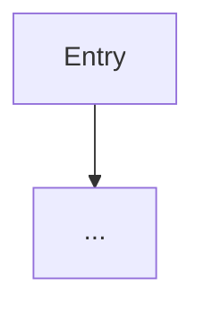

# Code review — chunk {{CHUNK_ID}} — {{CHUNK_NAME}}

| Field | Value |
|-------|--------|
| Program | {{PROGRAM_ID}} |
| Chunk doc | `plan/chunks/{{CHUNK_ID}}.md` |
| Reviewed | {{ISO}} |
| Commits | _(git shas)_ |

## Crisp summary (2 bullets only)

1. 
2. 

## How it reads (short)

_One paragraph — shape of the change set._

## Pseudocode (inferred actions)

```text
1. ...
2. ...
```

## Flow



## Code highlights

### `path/to/file.ext`

_Summary of this file’s role in the chunk._

```diff
(relevant diff hunks — main lines only)
```

## Index / cross-ref

- Index shards used: `docs/indexing/full-indexing-00X.md`
- Related acceptance: `verification/chunks/{{CHUNK_ID}}.html`

## Verdict

- [ ] Approve for checklist / goat
- [ ] Needs executionist iteration
